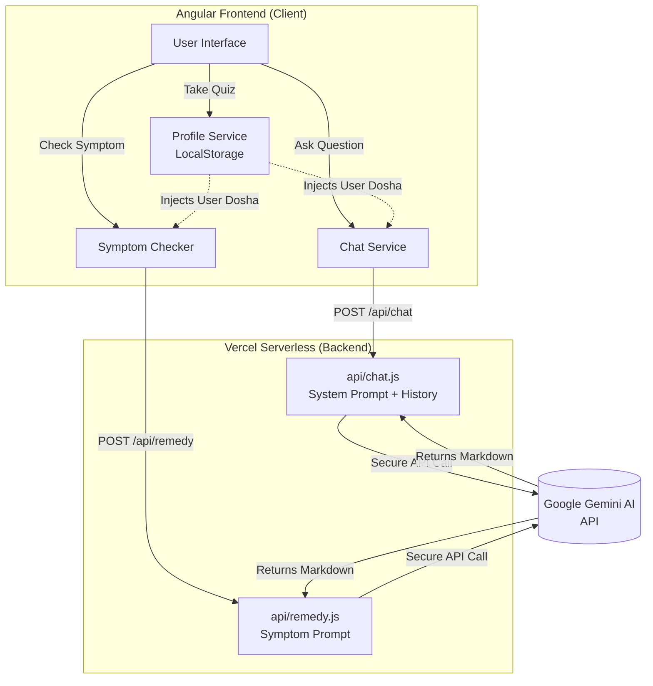

# 🌿 AyurvedaDaily

AyurvedaDaily is a personalized, AI-powered Ayurvedic wellness companion. It helps users discover their body constitution (Dosha), tracks their daily health routines, provides natural remedies, and features a context-aware AI chatbot that gives personalized wellness advice.

---

## 🌟 Key Features

- **Dosha Quiz**: Discover whether you are Vata, Pitta, or Kapha-dominant. Your profile is saved locally for a highly personalized experience across the app.
- **Context-Aware AI Chatbot**: Powered by Gemini AI. The chatbot knows your Dosha and tailors its dietary, lifestyle, and herbal advice specifically to your body type.
- **AI Symptom Checker**: Enter a symptom (e.g., "headache" or "stress") and get an instant, AI-generated Ayurvedic home remedy specifically formulated for your Dosha.
- **Interactive Daily Routine (Dinacharya)**: An interactive timeline of daily Ayurvedic practices. Check off practices as you complete them, and set browser notifications to remind you when it's time for your next routine.
- **Auto-Sorting Remedies & Herbs Library**: Explore a database of natural herbs and home remedies. The list automatically sorts itself to prioritize the remedies most beneficial for your specific Dosha.
-  **Feedback Features**: User can give according to their experiences.

---

## 🏗️ Architecture & Data Flow

The application uses a serverless architecture where the Angular frontend handles state management and UI, while Vercel Serverless Functions act as secure proxies for the Gemini AI APIs.



---

## 💻 Technology Stack

- **Frontend Framework:** Angular 22 (Standalone Components)
- **State Management:** Angular Signals
- **Styling:** Vanilla CSS with custom CSS variables (No external UI libraries)
- **Backend Proxy:** Vercel Serverless Functions (Node.js)
- **AI Integration:** Google Gemini 2.0 Flash API

---

## 🚀 Running Locally

### 1. Install Dependencies
```bash
npm install
```

### 2. Set Environment Variables
You will need a Gemini API key. Create a `.env` file in the root directory:
```env
GEMINI_API_KEY=your_api_key_here
```

### 3. Run the Development Environment
This project requires both the Angular dev server and a local Node API server to proxy the AI requests.
```bash
npm run dev:api
```
*(This command concurrently starts the Angular server on `http://localhost:4200` and the local API emulator on `http://localhost:3000`, proxying requests appropriately).*
